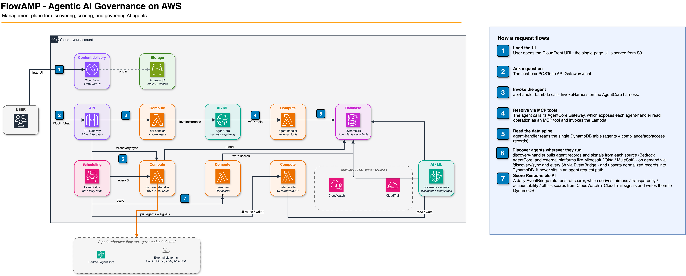
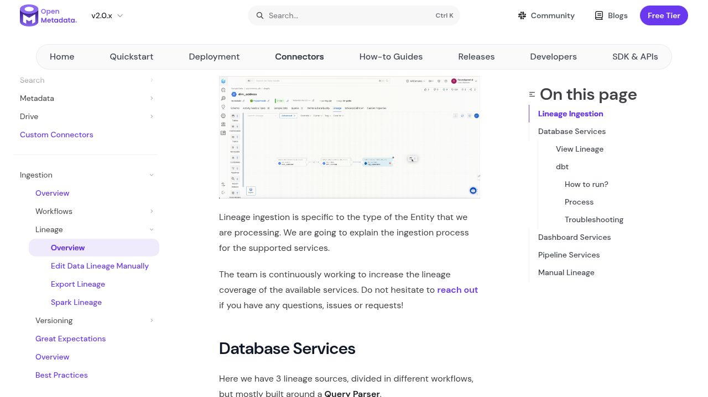
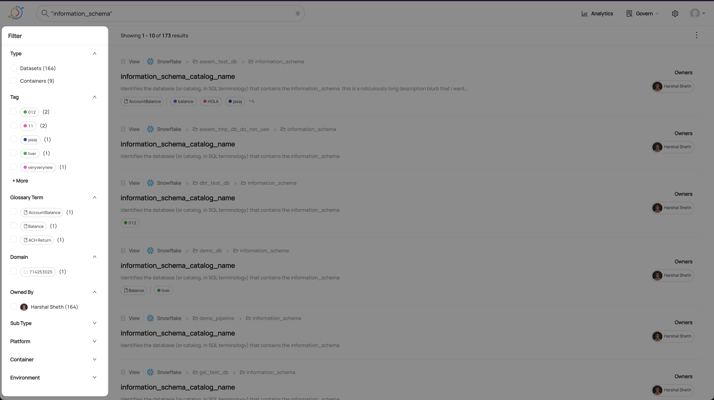
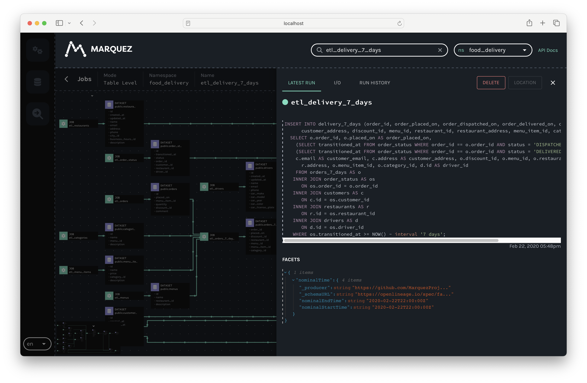

# Comparación de soluciones existentes

## Resumen

Data Lens necesita descubrir activos de datos y permitir que un consultor revise cómo se obtuvo cada resultado. **FlowAMP** sirve de referencia para la arquitectura de descubrimiento y hallazgos. Para la interfaz, **DataHub** muestra cómo buscar y distinguir activos, **OpenMetadata** cómo presentar la ficha de un activo y **Marquez** cómo explorar su linaje en un grafo navegable. **OpenLineage** aporta el formato de los eventos que pueden alimentar el grafo.

## Comparación rápida

| Referente | ¿De qué trata? | ¿Qué serviría en Data Lens? |
| --- | --- | --- |
| **FlowAMP** | Plataforma de inventario y gobernanza de agentes de IA. | **Inspiración de arquitectura.** Descubrimiento por API, registro común y detalle de hallazgos con acción sugerida. |
| **OpenMetadata** | Catálogo de activos con esquema, responsables, calidad y linaje. | **Inspiración de interfaz.** Ficha por activo. **Integración condicional** con la API de un catálogo existente. |
| **DataHub Core** | Catálogo para buscar y explorar activos de datos. | **Referencia de interfaz.** Buscar, acotar resultados con filtros y distinguir activos del mismo nombre mediante su ruta y plataforma. |
| **OpenLineage** | Especificación de eventos de linaje entre conjuntos de datos y procesos. | **Formato para alimentar la vista de linaje.** Los eventos identifican qué leyó y qué produjo cada ejecución. |
| **Marquez** | Servidor y visor de eventos OpenLineage. | **Referencia visual.** Mostrar el recorrido de los datos y abrir el detalle de cada proceso desde el grafo. |

## 1. FlowAMP · Arquitectura de descubrimiento y hallazgos

La muestra de AWS descubre agentes mediante APIs, guarda registros normalizados en DynamoDB y ejecuta controles que alimentan la interfaz. La arquitectura publicada separa la interfaz web, la API, los procesos de descubrimiento y el registro de agentes. [Repositorio oficial de FlowAMP](https://github.com/aws-samples/sample-flowamp-ai-agent-governance)

AWS Samples publica la muestra bajo MIT-0. El despliegue usa recursos de la cuenta, incluido AgentCore y acceso a un modelo Bedrock. El producto comercial de Pariveda tiene cotización privada en AWS Marketplace.

*Figura 1. Diagrama oficial de la muestra. Los pasos 5 y 6 muestran la relación entre el descubrimiento y el registro común.*

Separar el conector de cada servicio del modelo común de activos. Vincular cada hallazgo al activo, la ejecución, la comprobación y la evidencia que lo respalda. Este patrón encaja en la arquitectura prevista de Lambda, DynamoDB y S3. La comprobación de métricas seguiría usando reglas deterministas de Data Lens.

## 2. OpenMetadata · Catálogo e interfaz por activo

Reúne metadatos de diferentes fuentes y permite navegar por activos, sus esquemas y relaciones. Los conectores incorporan metadatos al catálogo, donde cada activo tiene una ficha con su contexto. [Repositorio oficial de OpenMetadata](https://github.com/open-metadata/OpenMetadata)

La edición autogestionada se puede desplegar sin suscripción, con infraestructura de aplicación, base de datos, búsqueda y ejecución de ingestas. La licencia raíz de la versión 2.0.7 es Apache-2.0. Su carpeta `ingestion/` tiene Collate Community License 1.0, que restringe, entre otros usos, ofrecer un servicio en línea que compita con los productos o servicios de Collate que proporcionan ese software. La licencia se debe revisar para el módulo y uso exactos.

Collate ofrece por separado un plan SaaS gratuito con límites de uso y funciones de linaje.

*Figura 2. Demostración de la interfaz en la documentación oficial. El activo funciona como punto de entrada al grafo y a su contexto.*

Usar una ficha que reúna esquema, contexto y evidencia del activo. Si el cliente ya opera OpenMetadata, consultar su API de tablas es una opción para enriquecer esa ficha, siempre que se pueda vincular cada registro con el activo correspondiente del inventario.

## 3. DataHub · Búsqueda y exploración del inventario

DataHub permite buscar activos desde un mismo catálogo y acotar los resultados por tipo, plataforma, dominio, etiquetas o responsable. Cada resultado muestra contexto antes de abrir la ficha, como el tipo de activo, su plataforma, su ruta y su responsable cuando está registrado. [Repositorio oficial de DataHub](https://github.com/datahub-project/datahub)

DataHub Core se puede autogestionar sin cargo de licencia. El código revisado está bajo Apache-2.0. Alojar el catálogo y operar la ingesta requieren infraestructura propia. DataHub Cloud es una oferta gestionada con precio a cotizar.

*Figura 3. Captura de la guía oficial de búsqueda de DataHub. A la izquierda se ven los filtros y el número de resultados por opción. A la derecha, la ruta de cada activo permite distinguir vistas con el mismo nombre.*

Incorporar un buscador al inventario con filtros por tipo de activo, servicio y cuenta. En cada resultado, mostrar el nombre, la ruta y el responsable si está registrado. Así, si aparecen dos tablas llamadas `pedidos`, el consultor puede distinguirlas por su origen y abrir la ficha correcta para revisar sus hallazgos y evidencias.

## 4. OpenLineage y Marquez · Cómo mostrar el linaje

Marquez presenta el linaje como un grafo navegable y permite abrir los detalles y el historial de un proceso desde la misma vista. El grafo se alimenta con eventos OpenLineage, que describen la ejecución, sus entradas y sus salidas. [Sitio oficial de Marquez](https://marquezproject.ai/) · [Sitio oficial de OpenLineage](https://openlineage.io/)

La especificación y el código de OpenLineage, así como Marquez, se publican bajo Apache-2.0. Operar Marquez añade un servidor API, una interfaz web y PostgreSQL.

*Figura 4. Vista de un job en la guía oficial de Marquez. Combina el grafo con el detalle de la última ejecución y su historial.*

Mostrar el recorrido **tabla de origen → proceso → tabla de destino** y permitir explorar qué alimenta a cada tabla y qué depende de ella. Al seleccionar un proceso, un panel lateral puede mostrar su última ejecución, la fecha, el estado y la evidencia que respalda la conexión. Si la fuente ya emite eventos OpenLineage, el prototipo podría usarlos para alimentar esa vista.
